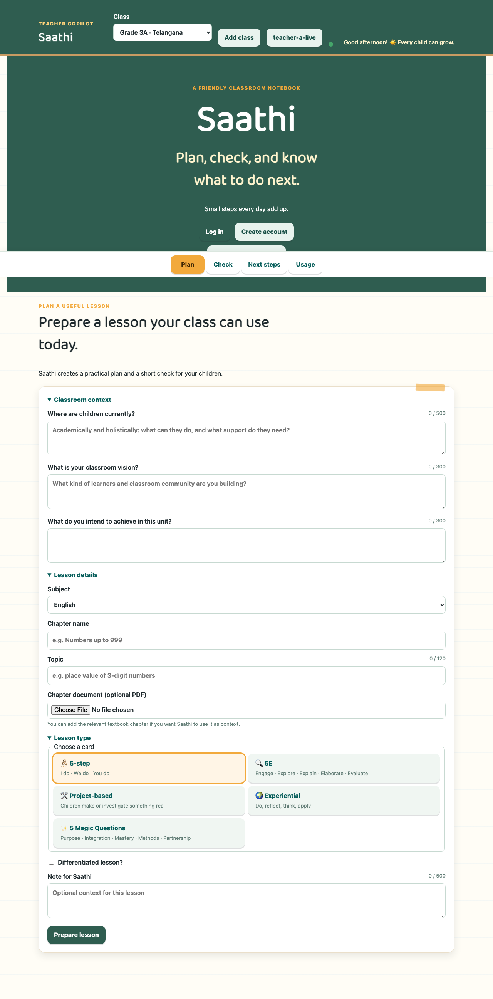

# Saathi

Saathi is an AI-supported classroom notebook for planning lessons, checking learning, and deciding what to do next.

## What Saathi does

The Plan tab helps a teacher create a practical lesson and a five-question check. In Check, the teacher imports a class roll, chooses the lesson key, and uploads completed answer sheets. Saathi reads the sheets, while code matches roll numbers, marks answers, and calculates class, student, and question mastery. Next steps turns confirmed evidence into coaching, worksheets, parent–teacher meeting plans, and a school-leader one-pager. Children’s names stay in the app and are not sent to the model.



## Run it locally in under 10 minutes

```bash
git clone https://github.com/UdayAddanki/saathi.git
cd saathi
python3 -m venv .venv
source .venv/bin/activate
pip install -r requirements.txt
```

Put `PORTKEY_API_KEY=...` in a `.env` file in this Saathi folder, or in the folder immediately above it. Then run:

```bash
python3 run.py
```

Open <http://localhost:8000> and click **Try the demo account**. A blank or missing `DEMO_MODE` enables the local demo; set `DEMO_MODE=false` to hide it.

## Try it with sample data

1. In Check step ①, upload `tests/fixtures/class_roll/class_roll_3A_valid.xlsx`.
2. Plan a Grade 3 Telangana place-value lesson.
3. In Check step ②, print the answer sheet.
4. In Check step ③, upload the five sheets in `tests/fixtures/submissions/grade3/` (or use **Load sample submissions** in demo mode).
5. The app reads and analyses the sheets automatically.
6. Open Next steps and Additional resources to view coaching, worksheets, meeting plans, and the school-leader one-pager.

The matching CSV roll fixture is `tests/fixtures/class_roll/class_roll_3A_valid.csv`; messy roll fixtures demonstrate flagged rows without guessing.

## How it works

| Agent | Purpose | Tools/data boundary |
|---|---|---|
| Planner | Writes the lesson | Class context and curriculum data |
| Check Builder | Writes the five-question check | Grade and lesson plan |
| Reviewer | Checks plans and checks | Code validation plus supplied draft |
| Answer Sheet Reader | Transcribes visible answers | Attached paper only; never marks |
| Next-Step Coach | Suggests next actions | Computed insight and roll numbers |
| Resource Builder | Writes worksheets and meeting plans | Computed insight, roll numbers, misconceptions, class profile |

Plain code owns authentication, roll matching, answer marking, mastery maths, budgets, ownership checks, confirmation, and names added back to teacher-facing resources.

## Tests

```bash
pytest
node --check static/app.js
pip install -r requirements-dev.txt
python -m playwright install chromium
python scripts/accounts_check.py --skip-plan
```

The accounts check uses a temporary database. Its normal mode makes the two real Plan calls; `--skip-plan` uses fake lesson data.

## Environment variables

| Variable | Purpose |
|---|---|
| `PORTKEY_API_KEY` | Portkey key for model calls; required for Plan and reading |
| `DEMO_MODE` | Local one-click demo; blank/missing means true, `false` disables it |
| `INVITE_CODE` | Optional sign-up invite code |
| `ADMIN_CODE` | Protects `/admin/pilot` |
| `TEACHER_DAILY_BUDGET_USD` | Per-teacher daily model budget |
| `DAILY_BUDGET_USD` | Global daily model budget |
| `DEMO_PASSWORD` | Demo account password |
| `APP_URL` | Public base URL for reset links |
| `SMTP_HOST`, `SMTP_PORT`, `SMTP_USER`, `SMTP_PASSWORD`, `MAIL_FROM` | Optional password-reset email settings |

See `.env.example` for the complete template.

## Project structure

```text
app/          FastAPI routes, database, agents, marking
static/       HTML, CSS, JavaScript, fonts, illustration
data/         Curriculum and local reference data
tests/        Automated tests and sample fixtures
scripts/      Browser checks and evidence scripts
evidence/     Screenshots and run evidence
docs/         Design specifications and project documents
```

The `docs/` folder contains the design documents and AI coding prompts used to build Saathi.
